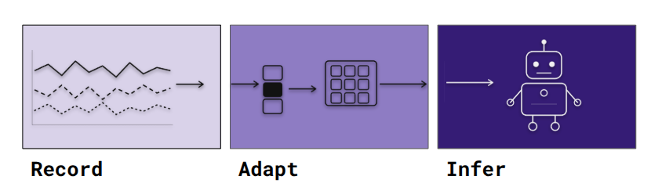

<h1 align="center">
  <font color="#8e7cc3">R</font>ethought<font color="#8e7cc3">A</font><font color="#8e7cc3">I</font>
</h1>

<p align="center">
  
  

</p>

<p align="center"><b>RAI - Record · Adapt · Infer</b></p>

  A ROS2-native pipeline for robot learning. Collect demonstrations, convert to training-ready datasets, and deploy trained policies.


---

## About

RAI is a 3-step pipeline for learning from demonstrations with ROS2: record, adapt, and infer.

---

## The Pipeline



**[recorder](recorder/)** — Record demonstrations to MCAP with live Rerun visualization. Trigger via physical buttons (Baxter, Sawyer) or keyboard (any robot).

**[adapter](adapter/)** — Convert MCAP recordings to LeRobot v3 datasets, quality-filter episodes, and push to HuggingFace Hub.

**[inference](inference/)** — Deploy a trained policy from HuggingFace back to your ROS2 robot.

---

## Supported Robots

| Robot | Config | Trigger |
|---|---|---|
| Baxter | [baxter.yaml](recorder/configs/baxter.yaml) | Digital IO buttons |
| Sawyer | coming soon | Digital IO buttons |
| Generic ROS2 | [generic.yaml](recorder/configs/generic.yaml) | Keyboard |

---

## Installation

Requires [uv](https://docs.astral.sh/uv/).

```bash
git clone https://github.com/RethoughtRobotics/RethoughtAI.git
cd RethoughtAI
uv sync
```

All three packages install into a single virtual environment.

```bash
uv run recorder --help
uv run adapter --help
uv run inference --help
```

---

## Quick Start

```bash
# 1. Record demonstrations
uv run recorder record --config baxter.yaml

# 2. Convert to LeRobot dataset and push to HuggingFace
uv run adapter convert --config configs/baxter.yaml \
  --input ./recordings \
  --push-to-hub yourname/your-dataset

# 3. Train with LeRobot (standard LeRobot workflow)
# https://github.com/huggingface/lerobot

# 4. Deploy a policy (ACT, SmolVLA, any LeRobot checkpoint): two ROS 2 nodes
uv run inference serve baxter.yaml --model yourname/your-model   # policy node (GPU)
uv run inference run baxter.yaml --model yourname/your-model     # runtime: drives the teleop
```

### Inference on ROS 2

```
cameras, /robot/joint_states,      ┌──────────────────────┐  /policy/left/chunk        ┌──────────────┐  /policy/left/target  ┌────────┐
gripper state, /teleop/left/tcp ──▶│ policy node (serve)  │──────────────────────────▶│ runtime (run) │──────────────────────▶│ teleop │──▶ arm
                                   │ LeRobot policy + RTC │  moveit_msgs/             │ merge chunks  │  /policy/left/trigger │ servo  │
                                   └──────────────────────┘  RobotTrajectory           └──────────────┘                       └────────┘
                                                             stamped at observation time
```

- **The policy node** runs any LeRobot checkpoint on the robot's topics in a worker thread and publishes
  each action chunk as a `moveit_msgs/RobotTrajectory`, plus `nav_msgs/Path` for RViz. The chunk's
  header stamp is the time of the observation it was computed from. Loading, normalization and
  tokenization are LeRobot's own (`make_pre_post_processors`). For flow policies (SmolVLA) the node
  uses LeRobot's Real-Time Chunking.
- **The runtime** merges the chunks by time and streams a target to the teleop at 100 Hz. Merge
  modes: ACT temporal ensembling, `latest` (for RTC), or a linear crossfade. Because each chunk
  carries its observation time, inference latency only shifts where execution starts in the chunk.
- **The two are separate processes,** so inference never blocks the control loop. Putting the GPU
  on another machine is a ROS networking question, not new code.
- **Per policy type settings** live in the config's `inference.policies` (`act`, `smolvla`, `vita`).
  On a laptop RTX 500 (4 GB) next to the sim: ACT ~30 ms, run every step; SmolVLA with RTC ~450 ms,
  run every 10 steps with `execution_horizon` 25 (it must exceed the delay in steps, ~13).

**Running a checkpoint** from `models/<name>_*/step-<N>/` opens tmux. When a prefix like
`--smolvla` matches several models, give the full name. The top pane runs the policy
(`launch/policy.launch.py`). The bottom pane has `./start` typed, ready to connect the policy to the
arm. `./stop` holds the arm where it is. `./home` sends it to the untuck pose with the gripper open,
as the controller's B button (with `./start` still on, the policy resumes fresh from there).

```bash
# bringbackbaxter: ./run_teleop.sh --left --policy (robot) or ./run_sim_teleop.sh --left --policy
./run_inference --act 100000                  # real robot: its cameras; sim: shadow of episode 4
./run_inference --smolvla_CupToContainer 30000 --episode 24   # sim: shadow of episode 24
./run_inference --smolvla_CupToContainer_wrist  # newest checkpoint, wrist camera only
```

With the robot's cameras up, the policy watches them. With none (the sim), it runs a **shadow
rollout**: it drives the arm while the policy watches a recorded episode's cameras, played by
`ros2 bag play`. `--episode` with live cameras is refused: the bag's frames would mix with theirs. The arm first moves to the episode's start pose, then the bag plays from the
episode's first step.

---

## Part of Rethought Robotics

<p>
  <a href="https://github.com/RethoughtRobotics/baxter-zenoh">
    
  </a>
  <a href="https://github.com/RethoughtRobotics/BaxterSDK">
    
  </a>
</p>
