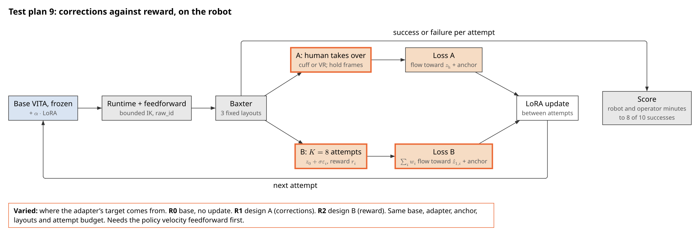
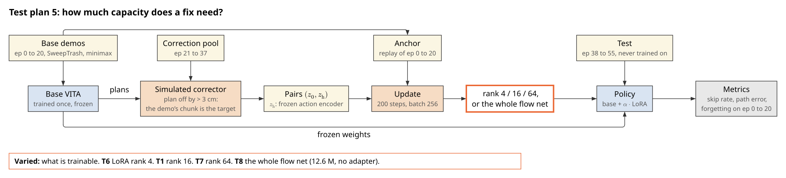
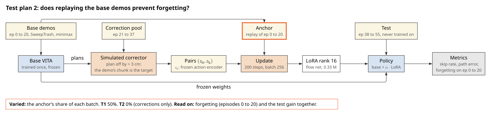
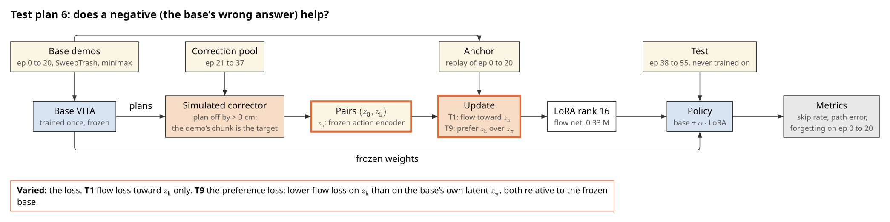
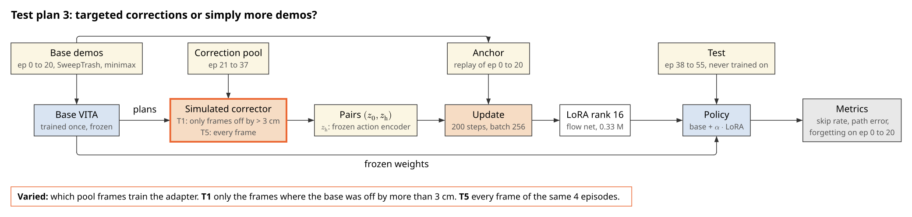
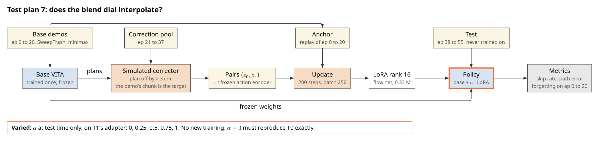
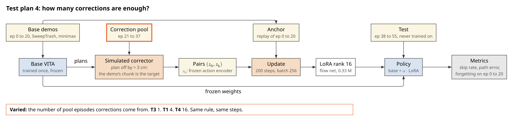

# Sim experiments

Plan, 2026-10-20. Every prediction below is written before any result exists. Companion to
[training_experiments.md](training_experiments.md), whose methods, losses and figures this plan
reuses; read that first.

## The question

**Can a frozen visuomotor policy be fixed at test time, from a handful of corrections or its own
attempts, by updating a small adapter, without losing what it already does, and faster per minute of
robot time than collecting more demonstrations, fine-tuning or reinforcement learning?**

A method paper that claims this has to show five things, in order, and this plan is built as those
five parts:

1. **The problem is real**: the base fails systematically, and more demonstrations alone do not fix
   it as cheaply (part 1).
2. **It beats the obvious alternatives**, the simplest first: fine-tuning, retraining with the
   corrections (DAgger), a residual policy, steering the latent, reward (part 2).
3. **Every component earns its place**: each part of the method removed or changed on its own
   (part 3).
4. **The correction signal is understood**: where corrections come from, how many, how good they
   must be, when to update (part 4).
5. **It generalises and transfers**: unseen conditions, other base policies and base strengths,
   repeated adaptation, and the sim's ranking confirmed on the robot (parts 5 and 6).

The real plan scores open loop on 18 recorded test episodes with a demonstration as the corrector.
The MuJoCo sim (BaxterSDK `baxter_mujoco`) runs the policy through the robot's own runtime, teleop,
IK and gripper, scores success itself, and supplies an expert that can correct any state the policy
reaches, so each question is answered closed loop, one factor at a time, with paired layouts and
several training seeds. Its fingers are shorter, it grasps the cup's wall higher and its images are
rendered: sim results rank methods; the robot sizes them (part 6).

## Data

The cup task (`BlueCupRedContainer` scene, the lab of `baxter_mujoco/lab.toml`), recorded with the
robot's recorder config and exported as the real cup data: measured TCP labels, no lead, left arm,
8-D action, 15-D state, left hand and third_eye cameras, 25 fps. Layouts lie in the real ranges
capped at the sim arm's reach (x at most 0.87 m); lighting is random per episode.

| Set | Source | Use |
|---|---|---|
| Base | episodes 0 to 20 (21, as the real base) | trains the base policy |
| Correction pool | episodes 21 to 37 (17) | offline corrections (the real plan's simulated corrector) |
| Test, open loop | episodes 38 to 55 (18) | path and progress error, comparable with the real plan |
| Adaptation layouts | 20 layouts, seeds 500 to 519 | where on-policy corrections and attempts are collected |
| Test, closed loop | 50 layouts, seeds 1000 to 1049 | success; never used to adapt or to choose anything |

`andnetdeboer/BlueCupRedContainer_sim` (seed 0) holds the generator's episodes 0 to 59.

### The references

Every plan changes one thing against these and keeps the rest.

| | Reference |
|---|---|
| **S0, the base** | VITA [1], the repository configuration, 30k steps, episodes 0 to 20, training seed 0; 32-step chunks, 16 run |
| **M0, the method** | the real plan's T1: LoRA [4] rank 16 on the flow net's 8 linear layers, $\mathcal{L}_1$ with anchor $\lambda = 0.5$, frames off by more than 3 cm, corrections from 4 pool episodes (21, 25, 29, 33), 200 steps, batch 256, learning rate 1e-4, $\alpha = 1$ |

## Shared method

### Base and adapter

As in the real plan: VITA flows an observation latent $z_0$ to an action latent; the adapter adds
$\alpha BA$ to frozen weights; $\ell_\phi$ is the flow-matching error and the anchor replays base
pairs. S0 is trained three times (seeds 0, 1, 2) and every adaptation is run with three update seeds;
both spreads together are the noise floor.

### Two correctors

- **Offline (the real plan's):** a pool demonstration's chunk is the target wherever the base's plan
  is more than 3 cm off it. Only states the demonstrations visited.
- **On-policy (the sim's):** the base runs on the adaptation layouts; wherever its plan is more than
  3 cm from the scripted planner's, replanned from the arm's current pose and the cup's current pose,
  the planner's chunk is the target. The states the policy itself reaches, as DAgger [5] and
  HG-DAgger [6] require.

### Closed-loop evaluation

`run_sim_teleop.sh --cup --cameras --left --policy` with the policy runtime (`scripts/run_inference`)
driving it, as on the robot. Per attempt: the layout and lighting of its seed, the arm and gripper at
home, the right arm parked, 40 s. Scored from the sim's object poses:

1. **Success**: the cup at rest in the container within 40 s (`CupTask.success`).
2. **Phase reached**: reach, grasp, transfer, release; the partial credit of a failure.
3. **Time to success** (s).
4. **Failure mode**: missed grasp, dropped in transit, released outside, stalled (5 s without
   progress), timeout.
5. **Forgetting**: success on the 50 test layouts minus the base's, restricted to layouts the base
   solved (did the update break what worked?).
6. **Cost**: corrected frames, attempts, simulated robot minutes, update compute (s on the robot
   computer's GPU).

Open-loop metrics on the 18 open-loop test episodes are the real plan's.

### Statistics

The unit is the **test layout** (50), paired across conditions. Success differences come with a 95%
bootstrap interval over layouts [7, 8]. **An effect counts** only if the interval excludes zero
**and** it exceeds the noise floor. Choices (thresholds, $\beta$, learning rates) are made on the
adaptation layouts, never on the 50 test layouts.

### Code to write

1. **Closed-loop evaluator**: per seed, set layout and lighting (`/sim/layout`, `/sim/lighting`),
   home, run the policy, watch `/sim/objects` and the gripper, stop at success or 40 s, one row per
   attempt, the bag kept.
2. **Planner as corrector**: `CupTask.plan` from the current TCP and the cup's current pose, and its
   chunk at any frame.
3. **Correction extraction** from evaluator bags: gated frames into $(z_0, z_\text{h})$ pairs.
4. The real plan's items 4 to 8 (latent cache, LoRA wrapper, corrector, update loop, evaluation),
   extended by the variants each plan below names.
5. **Adapter loading** and $\alpha$ in the policy runtime, so an adapted policy runs closed loop.

## Part 1: is there a problem worth fixing?

### Plan S1: how and where does the base fail?

**Inquiry.** Test-time correction is only interesting if the base's failures are systematic (the
same states, every time), not noise; a correction cannot teach a random failure.

**Hypothesis H-S1.** The three S0 bases fail on largely the same test layouts, in the same modes
(more than half of each base's failures shared by all three). **Null:** failures are independent
across seeds.

| # | Condition |
|---|---|
| S0, S0b, S0c | the base, training seeds 0, 1, 2, on the 50 test layouts |

**Expected outcome.** 40 to 70% success; failures concentrated in one or two modes and in shared
layouts. **Falsified if** the overlap of failed layouts across seeds is no larger than chance.
**Code to write.** Items 1 and 5.

### Plan S2: is it just a lack of data?

**Inquiry.** The cheapest fix is more demonstrations. A correction method has to beat that at equal
human effort, or it is a slower way to collect data (DAgger's argument [5]; the real test plan 3).

**Hypothesis H-S2.** Adapting S0 with corrections from 4 episodes raises success more than retraining
the base with those 4 episodes as whole demonstrations, and as much as retraining with 16 more.
**Null:** extra demonstrations match or beat corrections at equal episodes.

| # | Condition |
|---|---|
| S2a | base trained on 25 demonstrations (0 to 20 plus 21, 25, 29, 33) |
| S2b | base trained on 37 demonstrations (0 to 36) |
| S2c | base trained on 55 demonstrations |
| M0 | S0 plus corrections from 21, 25, 29, 33 |

**Expected outcome.** M0 above S2a, close to S2b; S2c above M0 but at 34 more demonstrations.
**Falsified if** S2a matches M0.
**Code to write.** None beyond the shared items.

## Part 2: against what? The alternatives, simplest first

### Plan S3: which weights should change?

**Inquiry.** The simplest test-time training is to fine-tune the policy on the corrections. LoRA
learns less and forgets less than full fine-tuning [12]; a frozen body with only the last layer
trained is the classic cheap alternative.

**Hypothesis H-S3.** LoRA with the anchor (M0) matches full fine-tuning on the test layouts and
forgets less; last-layer-only fixes less. **Null:** full fine-tuning is clearly better.

| # | Trainable, all with the same corrections, steps and anchor |
|---|---|
| S3a | everything (encoder, flow net, decoder) |
| S3b | the whole flow net |
| S3c | the flow net's last layer only |
| S3d | LoRA, no anchor ($\lambda = 0$): the simplest LoRA |
| M0 | LoRA with the anchor |

**Expected outcome.** S3a and S3b at most M0's gain, with more forgetting; S3c below M0; S3d close to
M0 on gain, worse on forgetting. **Falsified if** S3a or S3b beats M0 beyond noise with no more
forgetting.
**Code to write.** Trainable-set option in the update loop.

### Plan S4: retraining with the corrections (DAgger)

**Inquiry.** DAgger [5] aggregates the corrected states into the dataset and retrains from scratch:
the strongest data-centric baseline, at full training cost.

**Hypothesis H-S4.** Retraining on base plus corrected frames reaches M0's success but costs about
100 times its compute and forgets no less. **Null:** retraining is clearly better.

| # | Condition |
|---|---|
| S4 | the base retrained (30k steps) on episodes 0 to 20 plus M0's corrected frames |
| M0 | adapter, 200 steps |

**Expected outcome.** S4 within noise of M0 on success, at about 100 times the update compute.
**Falsified if** S4 is clearly above M0.
**Code to write.** Corrected frames as a LeRobot dataset (item 3).

### Plan S5: a residual policy

**Inquiry.** Instead of changing the base, learn a small correction added to its actions (residual
policy learning [27, 28]).

**Hypothesis H-S5.** A residual MLP on the action chunk, trained on the same corrections, fixes less
than M0, because the failure is in which chunk is chosen, not in its fine shape. **Null:** the residual
matches M0.

| # | Condition |
|---|---|
| S5 | residual MLP (same parameter count as M0's adapter) on the decoded chunk |
| M0 | adapter in the flow net |

**Expected outcome.** S5 below M0; its gain mostly in grasp precision, not in failures of the wrong
phase. **Falsified if** S5 matches or beats M0.
**Code to write.** Residual head and its training on item 3's pairs.

### Plan S6: steering the latent, no weights changed

**Inquiry.** DSRL [21] adapts a frozen diffusion policy by choosing its input noise; VITA has no
noise, but its starting latent $z_0$ can be offset the same way.

**Hypothesis H-S6.** A learned offset to $z_0$ fixes some failures but less than M0, and forgets
nothing by construction. **Null:** the offset matches M0.

| # | Condition |
|---|---|
| S6 | small network predicting an offset to $z_0$, trained on the corrections |
| M0 | adapter |

**Expected outcome.** S6 between S0 and M0; forgetting near zero.
**Falsified if** S6 matches M0.
**Code to write.** Offset network and its loss through the frozen flow.

### Plan S7: reward instead of corrections

**Inquiry.** Reward-weighted regression [19, 20] with the TTT-Discover temperature [13] learns from the
policy's own better attempts; RL fine-tuning of diffusion policies (DPPO [26]) optimises reward
directly. Neither needs an operator; both need attempts.

**Hypothesis H-S7.** At equal attempts, corrections (M0 on-policy, plan S15) reach 40 of 50 test
successes first; reward-weighted regression gets there with about three times the attempts; policy
gradient needs many more. **Null:** reward is as fast or faster.

| # | Condition |
|---|---|
| S7a | reward-weighted LoRA update: $K = 8$ seeded latent offsets per round, success plus progress reward |
| S7b | DPPO-style policy gradient on the adapter, same reward |
| S15 | on-policy corrections |

**Expected outcome.** Attempts to 40 of 50: S15 < S7a < S7b. **Falsified if** S7a needs no more
attempts than S15.
**Code to write.** The real plan's design B items, and a policy-gradient update on the adapter.

## Part 3: what in the method matters?

Each plan changes one component of M0.

### Plan S8: where the adapter sits

**Hypothesis H-S8.** The flow net (M0) is the right place: the failure is in which action the latent
flows to, not in perception. **Null:** the encoder or decoder does as well.

| # | Adapter on |
|---|---|
| S8a | the observation encoder |
| M0 | the flow net |
| S8b | the action decoder |
| S8c | all three |

**Expected outcome.** S8a and S8b below M0; S8c within noise of M0, forgetting more.
**Falsified if** S8a or S8b matches M0.

### Plan S9: how much capacity

The real test plan 5, closed loop.

| # | Rank |
|---|---|
| S9a | 1 |
| S9b | 4 |
| M0 | 16 |
| S9c | 64 |

**Hypothesis H-S9.** Ranks 4 to 64 within noise of each other; rank 1 below. **Null:** gain keeps
rising with rank. **Falsified if** S9c beats M0 beyond noise.

### Plan S10: replay against forgetting

The real test plan 2, closed loop, with forgetting measured on layouts the base solved.

| # | Anchor $\lambda$ |
|---|---|
| S10a | 0 |
| S10b | 0.25 |
| M0 | 0.5 |
| S10c | 0.75 |

**Hypothesis H-S10.** Forgetting falls as $\lambda$ rises, gain falls only above 0.5. **Null:** no
effect of $\lambda$ on forgetting. **Falsified if** S10a forgets no more than M0.

### Plan S11: the negative

The real test plan 6 (the base's own answer as the rejected sample [14, 15]), closed loop.

| # | Loss |
|---|---|
| M0 | $\mathcal{L}_1$ |
| S11 | $\mathcal{L}_1 + \mathcal{L}_\text{pref}$, $\beta$ chosen on the adaptation layouts |

**Hypothesis H-S11.** The negative adds a small gain. **Null:** none. **Falsified if** the interval
includes zero.

### Plan S12: which frames to train on

The real test plan 3, plus the gate's threshold.

| # | Frames |
|---|---|
| S12a | every frame of the 4 episodes |
| S12b | off by more than 1 cm |
| M0 | off by more than 3 cm |
| S12c | off by more than 6 cm |

**Hypothesis H-S12.** Gated frames beat all frames; 3 cm is near the best gate. **Null:** all frames
as good. **Falsified if** S12a matches or beats M0.

### Plan S13: how long to update

| # | Steps | Learning rate |
|---|---|---|
| S13a | 50 | 1e-4 |
| M0 | 200 | 1e-4 |
| S13b | 800 | 1e-4 |
| S13c | 200 | 1e-3 |

**Hypothesis H-S13.** Gain saturates by 200 steps; 800 steps or a 10 times rate forget more without
more gain. **Null:** gain keeps rising to 800. **Falsified if** S13b beats M0 beyond noise without
more forgetting.

### Plan S14: the blend dial

The real test plan 7, closed loop: M0's adapter at $\alpha$ = 0, 0.25, 0.5, 0.75, 1. **Hypothesis
H-S14.** Success and forgetting change monotonically with $\alpha$; $\alpha = 0$ reproduces S0.
**Falsified if** an intermediate $\alpha$ is worse than both ends.

## Part 4: the correction signal

### Plan S15: corrections on the policy's own states

**Inquiry.** The real plan's corrector labels states the demonstrations visited; the base fails in
states they did not. DAgger [5] and HG-DAgger [6] label the learner's own states.

**Hypothesis H-S15.** On-policy corrections, collected by running S0 on the adaptation layouts with
the planner gating at 3 cm, beat M0's offline corrections at the same number of corrected frames.
**Null:** no difference.

| # | Corrections |
|---|---|
| M0 | offline, from pool demonstrations |
| S15 | on-policy, the planner on S0's own attempts, the same frame count |

**Expected outcome.** S15 above M0, mostly fewer stalled attempts.
**Falsified if** the interval includes zero.

### Plan S16: how good must a correction be?

**Inquiry.** A person corrects late, partly and imprecisely; the sim's planner can be degraded on
purpose to measure what that costs.

| # | S15's corrections, degraded |
|---|---|
| S15 | exact |
| S16a | 0.5 s late |
| S16b | the first half of each chunk only |
| S16c | 2 cm Gaussian noise per waypoint |
| S16d | 30% of the gated frames dropped (the operator misses some) |

**Hypothesis H-S16.** Late corrections keep most of the gain; partial and noisy ones lose more but stay
above S0. **Null:** no degradation loses more than the noise floor.
**Falsified if** every degradation is within noise of S15.

### Plan S17: how many corrections?

The real test plan 4, on-policy and closed loop: corrections from 1, 2, 4, 8 and 16 failing attempts.
**Hypothesis H-S17.** Most of the gain by 4 attempts. **Null:** gain rises steadily to 16.
**Falsified if** the gain from 4 to 16 exceeds the gain from 1 to 4. Plotted against S2's
demonstration curve at equal operator minutes.

### Plan S18: update once, or after every attempt?

**Inquiry.** On the robot, corrections arrive one attempt at a time; updating between attempts lets
the next attempt fail differently.

| # | Schedule, 8 attempts in all |
|---|---|
| S18a | one update after all 8 |
| S18b | an update after every attempt, on all corrections so far |

**Hypothesis H-S18.** Updating after every attempt reaches the same success with fewer corrected
frames. **Null:** no difference. **Falsified if** S18b needs as many frames as S18a.

## Part 5: does it generalise?

### Plan S19: to conditions the corrections never saw

**Inquiry.** A fix that only holds on the layouts it was corrected on is memorisation.

**Hypothesis H-S19.** Corrections collected only on cups at x below 0.65 m improve test layouts beyond
0.65 m about as much as below; corrections under the lab's lighting hold under random lighting.
**Null:** gain only where corrected.

| # | Corrections from | Scored on |
|---|---|---|
| S19a | adaptation layouts with cups below 0.65 m | test cups below / beyond 0.65 m |
| S19b | adaptation layouts under the lab's lighting | test under random lighting |

**Expected outcome.** Gain beyond 0.65 m at least half the gain below. **Falsified if** the beyond
0.65 m gain is within noise of zero.

### Plan S20: other bases

**Inquiry.** A recipe tied to one architecture is a trick. The 278 M Multi-Task DiT is a diffusion
policy [25] with different internals.

| # | Base | Adapter |
|---|---|---|
| S0 / M0 | VITA | LoRA on the flow net |
| S20 / S20-M | Multi-Task DiT | LoRA on the denoiser's attention and MLP layers, same rank, loss, steps |

**Hypothesis H-S20.** The same recipe gives the DiT a gain within half of VITA's. **Null:** no gain on
the DiT. **Falsified if** S20-M's interval against S20 includes zero.

### Plan S21: weak and strong bases

**Inquiry.** Does test-time training rescue a weak policy, or only polish a good one?

| # | Base demonstrations | Then |
|---|---|---|
| S21a / S21a-M | 5 | M0's recipe |
| S0 / M0 | 21 | M0's recipe |
| S21b / S21b-M | 55 | M0's recipe |

**Hypothesis H-S21.** The absolute gain is largest for the middle base: the weak one fails in too
many ways, the strong one in too few. **Null:** the gain shrinks steadily with base strength.
**Falsified if** S21a-M gains more than M0.

### Plan S22: adapting again and again

**Inquiry.** Deployed, a policy is corrected repeatedly. Gains could add up, or the adapter could
drift.

| # | Condition |
|---|---|
| S22 | 5 rounds: each round 4 on-policy attempts on new adaptation layouts, corrected, update on all corrections so far |

**Hypothesis H-S22.** Success rises over the rounds and forgetting stays within the noise floor.
**Null:** success plateaus after round 1 or falls. **Falsified if** round 5 is below round 2.

### Plan S23: how much of each chunk to run

**Inquiry.** Running a long chunk ignores new observations; a correction can only act at the next
re-plan. The adapter's effect may depend on how often the policy re-plans.

| # | Chunk run of 32, base and adapted |
|---|---|
| S23a / S23a-M | 8 |
| S0 / M0 | 16 |
| S23b / S23b-M | 32 |

**Hypothesis H-S23.** The adapter's gain is larger when the policy re-plans more often (8). **Null:**
the gain does not depend on the chunk run. **Falsified if** the gain at 8 is within noise of the gain
at 16.

## Part 6: does the sim predict the robot?

### Plan S24: the same ranking on the robot

**Inquiry.** Sim results are only worth reporting if the order of methods holds on the robot.

**Hypothesis H-S24.** The robot ranks S0, M0, S15 and the best of part 2 in the sim's order (test plan
9's protocol, 10 attempts each, the same 3 layouts). **Null:** the orders disagree.

| # | On the robot |
|---|---|
| R0 | the real base |
| R-M0 | M0's recipe on real corrections |
| R-S15 | on-policy corrections from the operator |
| R-best | the strongest alternative from part 2 |

**Expected outcome.** The same order; absolute success lower than in the sim.
**Falsified if** any adjacent pair swaps beyond noise.
**Code to write.** The real plan's test plan 9 items.

## Results

Closed loop, 50 test layouts; success difference against S0 (part 1) or M0 (parts 2 to 5) with its
95% interval in brackets.

| # | Success of 50 | Difference | Forgetting | Time to success (s) | Corrected frames | Update compute (s) | Main failure mode |
|---|---|---|---|---|---|---|---|
| S0 | | | | | | | |
| S0b | | | | | | | |
| S0c | | | | | | | |
| S2a | | | | | | | |
| S2b | | | | | | | |
| S2c | | | | | | | |
| M0 | | | | | | | |
| S3a | | | | | | | |
| S3b | | | | | | | |
| S3c | | | | | | | |
| S3d | | | | | | | |
| S4 | | | | | | | |
| S5 | | | | | | | |
| S6 | | | | | | | |
| S7a | | | | | | | |
| S7b | | | | | | | |
| S8a | | | | | | | |
| S8b | | | | | | | |
| S8c | | | | | | | |
| S9a | | | | | | | |
| S9b | | | | | | | |
| S9c | | | | | | | |
| S10a | | | | | | | |
| S10b | | | | | | | |
| S10c | | | | | | | |
| S11 | | | | | | | |
| S12a | | | | | | | |
| S12b | | | | | | | |
| S12c | | | | | | | |
| S13a | | | | | | | |
| S13b | | | | | | | |
| S13c | | | | | | | |
| S14 | | | | | | | |
| S15 | | | | | | | |
| S16a | | | | | | | |
| S16b | | | | | | | |
| S16c | | | | | | | |
| S16d | | | | | | | |
| S17 | | | | | | | |
| S18a | | | | | | | |
| S18b | | | | | | | |
| S19a | | | | | | | |
| S19b | | | | | | | |
| S20 | | | | | | | |
| S20-M | | | | | | | |
| S21a | | | | | | | |
| S21a-M | | | | | | | |
| S21b | | | | | | | |
| S21b-M | | | | | | | |
| S22 | | | | | | | |
| S23a | | | | | | | |
| S23a-M | | | | | | | |
| S23b | | | | | | | |
| S23b-M | | | | | | | |

Robot (S24), test plan 9's format.

| # | Successes of 10 | Robot minutes to 8 of 10 | Operator minutes | Takeovers |
|---|---|---|---|---|
| R0 | | | | |
| R-M0 | | | | |
| R-S15 | | | | |
| R-best | | | | |

## Threats to validity

- **The sim is not the robot.** Shorter fingers, a higher wall grasp, rendered images, a scripted
  demonstrator; part 6 is what licenses the sim's rankings.
- **A scripted expert is a perfect corrector.** S16 measures imperfection on purpose, but human
  corrections differ in ways a degraded planner may not capture.
- **One task in the sim.** The cup task has no shortcut like the sweep's; generality across tasks
  rests on the real plan's two tasks and on new sim tasks if part 5 is promising.
- **Reach.** Layouts are capped at the sim arm's reach (0.87 m).
- **One draw of test layouts.** Any result close to the noise floor is rechecked on a second set of 50.

## References

Numbers 1 to 24 are those of [training_experiments.md](training_experiments.md).

[25] C. Chi et al., "Diffusion Policy: Visuomotor Policy Learning via Action Diffusion," RSS 2023.
[arXiv:2303.04137](https://arxiv.org/abs/2303.04137)

[26] A. Z. Ren et al., "Diffusion Policy Policy Optimization," ICLR 2025.
[arXiv:2409.00588](https://arxiv.org/abs/2409.00588)

[27] T. Silver, K. Allen, J. Tenenbaum, L. Kaelbling, "Residual Policy Learning," 2018.
[arXiv:1812.06298](https://arxiv.org/abs/1812.06298)

[28] T. Johannink et al., "Residual Reinforcement Learning for Robot Control," ICRA 2019.
[arXiv:1812.03201](https://arxiv.org/abs/1812.03201)
