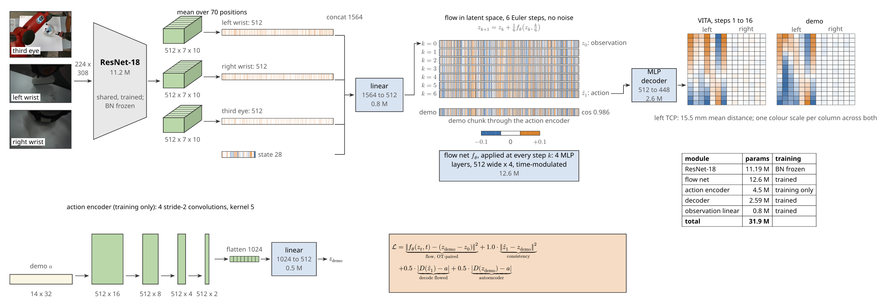
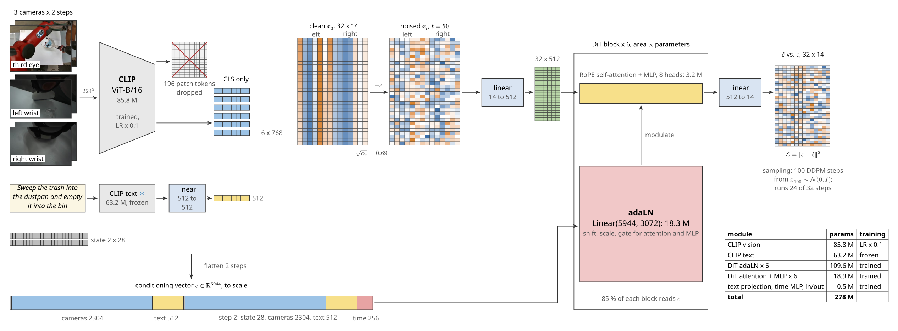
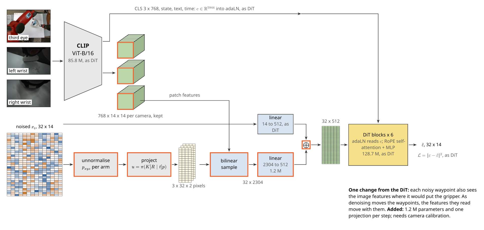
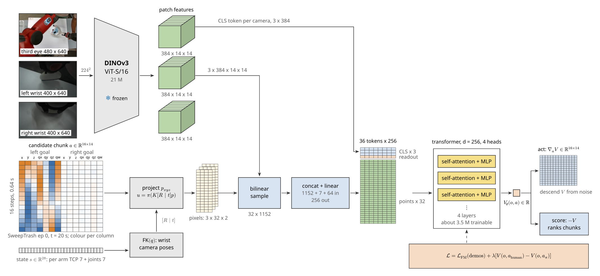
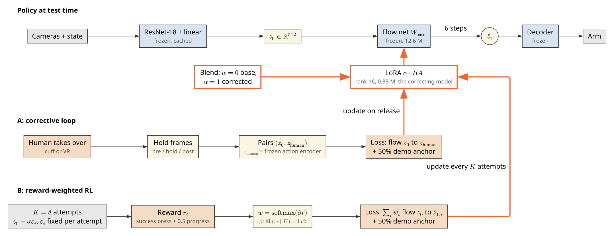
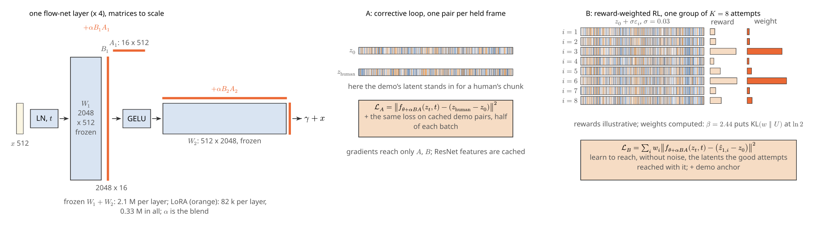
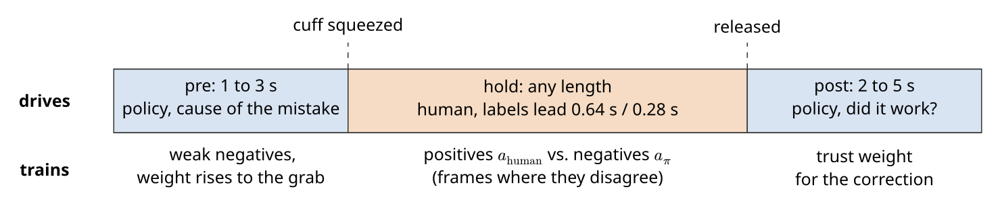
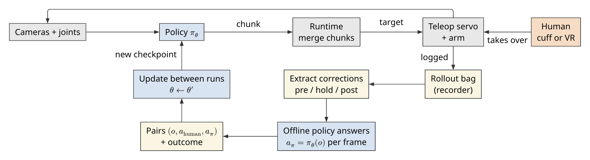

# Training experiments: few-shot shortcuts and test-time correction

Planned 2026-10-19; first runs tonight, results to read 2026-10-20.

## Context

Trained on hand-guided demonstrations of the dustpan task (place the pan with the right arm, sweep
the trash in with the left, carry it to the bin, empty it, return), policies take a **shortcut**: they
position the pan, skip the sweep or make one token stroke, and go straight to carrying an empty pan.
The policies that did this were trained on 21 to 56 demonstrations, so "too few demos" is only one of
several explanations. The others: a single-frame policy cannot tell "before the sweep" from "after it",
the operator visible in the demonstrations gives the phase away, and the label lead changes what the
policy is asked to predict.

These experiments separate those explanations, one change at a time, and set up the baseline that
test-time correction (methods M5 and M6) will start from.

**Rule for every comparison:** two runs differ in exactly one thing. A difference smaller than the
gap between two seeds of the same run (runs 1 and 2) is not a finding.

## Ground rules (no cross-contamination)

| Item | Rule | Why |
|---|---|---|
| Held-out episodes | **3, 10, 17, 24, 31, 38, 45, 52** (8 of 56, spread across sessions) | The same 8 for every run, so every run is tested on the same thing |
| How they are held out | **Train-only dataset copies** with those 8 removed (step 0 below) | The `task` backend (VITA, DiT) trains on every episode and refuses an episode list (`train.py` `task_cmd`); switching some runs to the `lerobot` backend would change the training loop for those runs only |
| Identical frames | Before launching, check every variant has 56 episodes with identical lengths | The inpainted and lead variants must be the same frames, or the pairs are not pairs |
| Training | 30k steps, the policy's config batch size, seed 42, same augmentation | Only the named change differs |
| Checkpoint | The final step only | Picking a step by held-out score leaks the test set into the choice |
| Fewer demos | Nested and fixed: 12 in 24 in 48, spread across sessions | Otherwise "fewer demos" also means "different demos" |
| Evaluation images | The **inpainted (minimax)** held-out frames, for every model | At deployment no operator is in view; raw frames keep the operator cue in the test set and flatter a model that learned it |
| Robot tests | No help by hand. A takeover is logged as a correction and the attempt counts as a failure | The 2026-10-15 rollouts mixed policy and operator and cannot be read as policy behaviour |

### Step 0: train-only datasets

Remove episodes 3, 10, 17, 24, 31, 38, 45, 52 from each source and publish the result as its own
dataset (for example with LeRobot's dataset editing tool), then add one `datasets/*.yaml` per copy:

| Copy | Source | Episodes |
|---|---|---|
| `..._minimax_lead640ms_train48` | `SweepTrash_Kin-Full_inpainted_minimax_lead640ms` | 48 |
| `..._minimax_lead640ms_train24` | the same | 24, a fixed subset of the 48 |
| `..._minimax_lead640ms_train12` | the same | 12, a fixed subset of the 24 |
| `..._minimax_train48` | `SweepTrash_Kin-Full_inpainted_minimax` (lead 0) | 48 |
| `SweepTrash_Kin-Full_train48` | `SweepTrash_Kin-Full` (raw, lead 0) | 48 |

Record the exact episode lists of the 24 and 12 subsets in their YAML comments.

## Metrics

One evaluation script, run once over every checkpoint, open-loop on the 8 held-out episodes. Each
metric is computed per episode and reported as the median and range over episodes: frames within an
episode are correlated, so the episode is the unit.

1. **Future-pose error (mm).** Each predicted waypoint against the arm's recorded pose at the time
   that waypoint stands for: a lead-640 ms model's first waypoint is the pose 0.64 s ahead, a lead-0
   model's is the current pose. Both kinds of model are measured against the real trajectory, never
   against each other's labels.
2. **Sweep-skip rate.** On held-out frames in the sweep phase (task progress 0.2 to 0.55), the share
   whose predicted chunk best matches a demonstration segment past 0.6. The matching (each chunk
   against every 31-step segment of the training demos, both TCP positions) recovers a held-out
   demo's own progress to a median error of 0.055 (90th percentile 0.19).
3. **Error per phase.** Metric 1 split into place, sweep, carry, empty.

Multi-Task DiT samples from noise, so it is evaluated with 5 fixed noise seeds and averaged.

## Methods

### M1: VITA (baseline)

The trained `vita_SweepTrash_Kin-Full_inpainted_minimax_lead640ms_aug_30k_r1` checkpoint, every
latent and chunk in the figure its own output on episode 0 at t = 20 s.

- **31.9 M parameters.** One ResNet-18 shared by the three cameras; each camera's 512 x 7 x 10 feature
  map is **averaged over its 70 positions** into one vector. The policy never sees where things are.
- Flows **without noise** from the observation latent $z_0$ to an action latent in 6 Euler steps;
  the decoder turns that into 32 x 14 and the first 16 steps run. The same observation always gives
  the same chunk.
- On this one frame the flowed latent reaches cosine 0.971 with the demonstration's encoded latent
  (0.51 at the start of the flow), and the left TCP lands 13.9 mm from the demonstration on average.
  One frame of a training episode, raw where training was inpainted: an illustration, not a result.

### M2: Multi-Task DiT

The trained `multi_task_dit_SweepTrash_Kin-Full_inpainted_minimax_lead640ms_aug_30k_r1`, drawn from its
config and weights, with a real chunk noised at step 50 of 100.

- **278 M parameters**, about 215 M trained (CLIP vision at a tenth of the learning rate, CLIP text
  frozen).
- Each image becomes **one 768-D CLS vector**; all 196 patch tokens are dropped. Two observation steps
  of 3 cameras + state + text are flattened into one 5944-D vector.
- That vector enters each of the 6 blocks only through adaLN, `Linear(5944, 3072)`: **85% of the DiT's
  parameters** (109.6 M of 128.7 M) are these layers, against 3.2 M per block for attention and MLP.
- DDPM, epsilon prediction, 100 sampling steps; 24 of 32 steps run.

### M3: DiT + BIND (needs code and camera calibration)

The DiT unchanged plus one path (orange): each noisy waypoint is projected into each camera and reads
the CLIP patch features at that pixel, added to its token. As denoising moves the waypoints, the
features they read move with them. 1.2 M added parameters. It tests whether **local image features at
the action's own location** help, with the objective held fixed. Needs the third-eye camera's
intrinsics and extrinsics, which nothing in the repo has yet.

### M4: Energy potential V (needs code and camera calibration)

One network that both acts and scores: a frozen DINOv3 encoder, the candidate chunk projected into
each camera (BIND), a small transformer, and one number $V_\theta(o, a)$. Its gradient generates
chunks (Energy Matching); its value ranks them. Trained with flow matching on demonstrations plus a
contrastive term on corrections: energy down on the human's chunk, up on the policy's own. With M3
it completes a 2 x 2: {global, projected features} x {diffusion, energy}.

### M5 and M6: test-time training on VITA

Shared by both: VITA frozen; the **correcting model is a LoRA adapter** (rank 16) on the flow net's 8
linear layers, 0.33 M parameters, 2.6% of the flow net; the **blend is the adapter's scale**
$\alpha$ ($\alpha = 0$ the original policy, $\alpha = 1$ fully corrected), so undo is free. ResNet
features and $z_0$ are cached, so an update is MLP arithmetic on 512-D vectors. Half of every update
batch is cached demonstration pairs with the usual flow loss, so the adapter cannot drift from the
demonstrations.

- **M5, corrective loop.** The operator takes over (cuff or VR) and lets go. Each held frame gives a
  pair ($z_0$, $z_\text{human}$), $z_\text{human}$ from VITA's own frozen action encoder; the adapter
  learns the flow from $z_0$ to $z_\text{human}$. Dense signal, the operator's time. Closest prior
  work: HG-DAgger.
- **M6, reward-weighted RL.** VITA has no noise, so each of $K = 8$ attempts runs with a fixed latent
  offset $z_0 + \sigma \epsilon_i$. Reward: the operator's success press plus 0.5 x motion progress
  without jumping the sweep. Weights $w = \mathrm{softmax}(\beta r)$ with $\beta$ set so
  $\mathrm{KL}(w \| U) = \ln 2$ (TTT-Discover's rule). The adapter learns to reach, without the offset,
  the latents the good attempts reached with it. Sparse signal, robot time. Closest prior work: DSRL.

M5 and M6 share everything but the target the adapter learns, so a difference between them is the
signal, not the machinery.

**What one correction is:**

## Tonight's runs

Baseline **B** = M1 (VITA), `..._minimax_lead640ms_train48`, 1 observation frame, seed 42. Each run
differs from the run in "compare with" in exactly the named change.

| # | Method | Dataset copy | Change | Compare with | Question |
|---|---|---|---|---|---|
| 1 | M1 | `minimax_lead640ms_train48` | none (B) | | baseline |
| 2 | M1 | `minimax_lead640ms_train48` | seed 7 | 1 | noise floor: smaller gaps are not findings |
| 3 | M1 | `minimax_lead640ms_train48` | `n_obs_steps: 2` | 1 | does a second frame stop the sweep skip? |
| 4 | M1 | `minimax_train48` | label lead 0 | 1 | do lead-640 ms labels matter? |
| 5 | M1 | `SweepTrash_Kin-Full_train48` | raw frames (no inpainting) | 4 | does the operator in view create a shortcut? (the raw set has only lead 0, so its pair is 4) |
| 6 | M1 | `minimax_lead640ms_train24` | 24 demos | 1 | few-shot curve |
| 7 | M1 | `minimax_lead640ms_train12` | 12 demos | 6, 1 | few-shot curve |
| 8 | M2 | `minimax_lead640ms_train48` | architecture | 1 | VITA against DiT at 48 demos |
| 9 | M2 | `minimax_lead640ms_train12` | architecture at 12 demos | 8, 7 | does DiT fall off faster with fewer demos? |

Measured cost on an RTX 6000 Ada: VITA 4.8 steps/s (about 1.7 h for 30k), DiT 1.4 steps/s (about
6 h). Run 9 is the one deliberate two-factor cell, read only against both of its neighbours.

## Next runs (need code first)

| # | Method | Change from | Question |
|---|---|---|---|
| 10 | M5 on run 1 | offline: 4 held-out episodes' sweep frames as corrections, scored on the other 4 | do a few corrections remove the skip without forgetting the rest? |
| 11 | M3 | run 8, plus projected features | do local features help the DiT? |
| 12 | M4 | run 11's projected features, energy instead of diffusion | does the objective matter once features are local? |
| 13 | M6 on run 1 | robot, $K = 8$, 3 updates | does reward-weighted RL fix what M5 fixes, per minute of robot time? |

## Results

Fill in from the evaluation script; median over the 8 held-out episodes (range in brackets).

| # | Future-pose error (mm) | Sweep-skip rate | Sweep-phase error (mm) | Notes |
|---|---|---|---|---|
| 1 | | | | |
| 2 | | | | |
| 3 | | | | |
| 4 | | | | |
| 5 | | | | |
| 6 | | | | |
| 7 | | | | |
| 8 | | | | |
| 9 | | | | |

## Limits

- Open-loop metrics screen; they do not measure task success. The best two runs and B go to the robot.
- One task, one operator, one robot.
- The dataset copies recompute normalization statistics without the held-out episodes, as they should;
  the original checkpoints did not, so they are not comparable to these runs.

Figure sources and the data they read: [`figures/src/`](figures/src/README.md).
