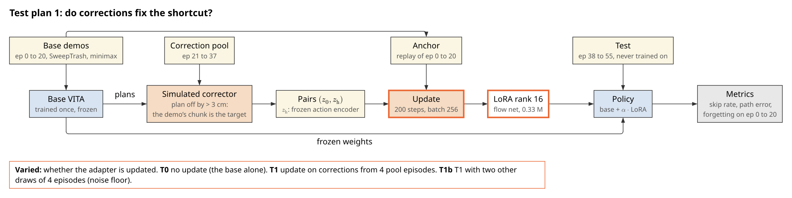
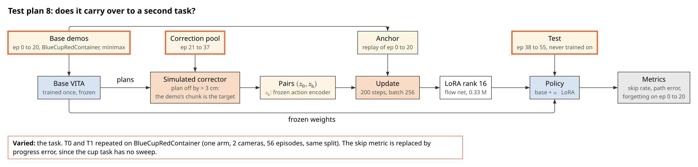

# Test-time training experiments

Plan, 2026-10-19. Every prediction below is written before any result exists.

## The question

A policy trained on a few demonstrations of a multi-step task takes shortcuts: on the dustpan task it
places the pan, skips the sweep and carries an empty pan to the bin. **Can it be fixed at test time,
from a few corrections or its own attempts, by updating a small adapter on the frozen policy, without
losing what it already does well?** And which signal teaches faster, a human's corrections or reward
on its own attempts?

## Data

Both tasks use hand-guided demonstrations with **no lead** (labels are the measured pose) and
**minimax** inpainting (operator removed).

| Task | Dataset | Episodes | Labels | Arms | Action / state | Cameras |
|---|---|---|---|---|---|---|
| Sweep | `andnetdeboer/SweepTrash_Kin-Full_inpainted_minimax` | 56 | measured; the published copy is shifted 1 sample (40 ms), so it is re-exported with no shift (code item 1) | 2 | 14 / 28 | 3 |
| Cup | `andnetdeboer/BlueCupRedContainer_kin_pose_inpainted_minimax` | 56 | measured, no lead | 1 | 8 / 15 | 2 |

The same split for both tasks, fixed now:

| Set | Episodes | Use |
|---|---|---|
| Base | 0 to 20 (21) | trains the base policy; replayed as the anchor; forgetting is measured here |
| Correction pool | 21 to 37 (17) | the only source of corrections |
| Test | 38 to 55 (18) | never used to train or to choose anything; every result is measured here |

## Shared method

### The base policy: VITA, trained once and frozen

VITA [1] flows from an observation latent $z_0$ to an action latent $z_1$ with no noise source (flow
matching [2], minibatch optimal-transport pairing [3]), then decodes a 32-step chunk of which 16 run.
One base per task is trained on episodes 0 to 20 with the repository's VITA configuration (30k steps)
and never changed again. The figure is the no-lead sweep checkpoint (`vita_SweepTrash_Kin-Full_inpainted_aug_30k_r1`) traced on one frame.

### What learns at test time: a LoRA adapter

LoRA [4] adds a trainable low-rank product $BA$ to a frozen weight $W$: the layer computes
$(W + \alpha BA)x$. Here it sits on the flow net's 8 linear layers (rank 16: 0.33 M parameters, 2.6%
of the flow net). Everything else in VITA stays frozen, so $z_0$ and the action encoder's latents are
computed once per frame and cached. $\alpha$ blends: 0 is the base policy, 1 the adapted one.

**Notation used by every loss.** For a pair $(z_0, z_1)$ and $t \sim \mathcal{U}(0, 1)$, let
$z_t = (1 - t)\, z_0 + t\, z_1$ and

$$\ell_\phi(z_0, z_1) = \mathbb{E}_t \left\| f_\phi(z_t, t) - (z_1 - z_0) \right\|^2,$$

the flow-matching error of the flow net $f_\phi$ with weights $\phi = \theta + \alpha BA$ ($\theta$
frozen). The **anchor** replays base pairs $(z_0, z_\text{demo})$ from episodes 0 to 20 with the same
$\ell$.

### What one correction is

**The simulated corrector (offline).** On the robot a human takes over when the policy goes wrong.
Offline, the demonstration plays the human: a frame of a correction-pool episode is corrected when the
base's planned executed waypoints are on average more than **3 cm** from where the demonstration went
(both arms for sweep). Its target $z_\text{h}$ is the frozen action encoder's latent of the
demonstration's chunk at that frame. This follows the interactive-imitation setting of DAgger [5] and
its human-gated form, HG-DAgger [6], where the expert labels the states the learner itself reaches.

### Metrics (open loop, on the 18 test episodes)

1. **Sweep-skip rate** (sweep only, primary). Among test frames in the sweep phase (task progress 0.2
   to 0.55), the share whose predicted chunk best matches a demonstration segment past progress 0.6.
   Matching each chunk against every 31-step segment of the base episodes recovered a held-out
   demonstration's own progress to a median error of 0.055 (90th percentile 0.19).
2. **Progress error** (both tasks). The absolute difference between a chunk's matched progress and
   the frame's true progress.
3. **Path error (mm).** Mean distance between predicted and demonstrated executed waypoints; overall
   and per phase.
4. **Forgetting (mm).** Path error on base episodes 0 to 20, adapted minus base.

### Statistics

The unit is the **test episode** (18), not the frame: frames within an episode are correlated.
Comparisons are paired (same episodes), reported as the median difference with a 95% bootstrap
interval [7] over episodes, following the interval-first reporting of [8]. **An effect counts** only
if its interval excludes zero **and** it is larger than the spread of the three T1 draws (test plan
1). Nothing is tuned on test episodes; a setting chosen later is chosen on the correction pool and
reported as such.

### Code to write (shared by test plans 1 to 8)

What exists: VITA training and inference, the LeRobot datasets, the progress matching (prototype from
the stopped rollout analysis). What does not:

1. **No-lead sweep labels.** The published sweep copy labels each frame with the pose one sample
   later (`lead_steps: 1`). Re-export it with `lead_steps: 0` so the label is the measured pose itself,
   as the cup data already is. The velocity feedforward replaces any lead in the controller.
2. **Base training data.** Train-only copies holding episodes 0 to 20 (`..._minimax_ep0-20`, both
   tasks), so normalisation statistics never see the pool or test episodes, plus a `datasets/*.yaml`
   each, as the existing `datasets/sweep_*.yaml` copies are made.
3. **Two base runs** (sweep, cup) through `lerobot-train` (the `lerobot` backend): the `vita_sweep`
   config for SweepTrash, since the `task` backend's script is written for the single-arm cup task and
   cannot read it. No new code once items 1 and 2 exist.
4. **Latent cache.** Run each frozen base over every frame of episodes 0 to 55 once and store $z_0$,
   the base's flowed latent $z_\pi$ and its decoded chunk, and $z_\text{demo}$ (action encoder of the
   demonstration's chunk).
5. **LoRA wrapper** on the flow net's `fc1` and `fc2` layers, with rank and $\alpha$ as parameters.
6. **Simulated corrector:** the 3 cm rule over the cache.
7. **Update loop** over cached latents: the flow loss, the anchor mix, the preference loss of test plan
   6, the full fine-tune option of test plan 5; 200 steps, batch 256, learning rate 1e-4, seeded.
8. **Evaluation:** decode with any $\alpha$; path error overall and per phase; forgetting; progress
   matching and skip rate; bootstrap intervals; one results table per run.
9. **Phase labels.** Sweep: progress bands (place 0 to 0.2, sweep 0.2 to 0.55, carry 0.55 to 0.8,
   empty and return 0.8 to 1), checked on 3 base episodes. Cup: from the gripper channel (reach until
   it closes, transfer while closed, release after it opens).

## Test plan 1: do corrections fix the shortcut?

**Inquiry.** Imitation learners fail on states their demonstrations never reached, and errors
compound; DAgger [5] fixes this by having an expert label the learner's own states, and HG-DAgger [6]
lets the expert take over only when needed. Physical corrections carry information about the task,
not just noise [9]. LoRA [4] adapts a large frozen model with few parameters. Whether a few corrected
frames, applied as a LoRA update to a frozen flow policy, remove a learned shortcut on unseen
episodes has not been shown.

**Hypothesis H1.** A LoRA update on corrections from 4 pool episodes lowers the sweep-skip rate on the
test episodes. **Null:** no change beyond the noise floor.

**Loss.** With $C$ the corrected pairs and $D$ the anchor pairs, $\lambda = 0.5$:

$$\mathcal{L}_1 = (1 - \lambda)\, \mathbb{E}_{(z_0, z_\text{h}) \in C}\, \ell_\phi(z_0, z_\text{h}) + \lambda\, \mathbb{E}_{(z_0, z_\text{demo}) \in D}\, \ell_\phi(z_0, z_\text{demo})$$

| # | Condition |
|---|---|
| T0 | base, no update |
| T1 | $\mathcal{L}_1$, corrections from pool episodes 21, 25, 29, 33 |
| T1b | T1 with episodes 22, 26, 30, 34 and 23, 27, 31, 35 (three draws in all) |

**Expected outcome.** T1's sweep-skip rate at most half of T0's, with path error in the sweep phase
lower and elsewhere unchanged. The three draws agree within a few percentage points.
**Falsified if** the T1 against T0 interval includes zero or is within the T1b spread.

**Code to write.** Shared items 1 to 9.

## Test plan 2: does replaying the base demonstrations prevent forgetting?

**Inquiry.** Training on new data overwrites what a network learned before (catastrophic forgetting
[10]). Replaying old data alongside new is a simple, strong defence [11], and LoRA by itself already
forgets less than full fine-tuning [12]. Whether a LoRA update on a few corrections still needs replay
is the question.

**Hypothesis H2.** Without the anchor, forgetting on episodes 0 to 20 rises while the test gain stays
similar. **Null:** forgetting is the same with and without it.

**Loss.** $\mathcal{L}_1$ with $\lambda = 0.5$ (T1) against $\lambda = 0$ (T2).

| # | Condition |
|---|---|
| T1 | $\lambda = 0.5$ |
| T2 | $\lambda = 0$ |

**Expected outcome.** T2's forgetting clearly above T1's; test gains within noise of each other.
**Falsified if** T2's forgetting interval overlaps T1's.

**Code to write.** None beyond the shared items ($\lambda$ is a parameter of item 7).

## Test plan 3: targeted corrections, or simply more demonstrations?

**Inquiry.** DAgger's argument [5] is that labels on the learner's own mistakes are worth more than
labels on states it already handles. If that holds, training only on the frames where the base was
wrong should beat training on whole episodes, which are mostly frames it already gets right.

**Hypothesis H3.** At the same 4 episodes, corrected frames only (T1) lower the sweep-skip rate more
than all frames (T5). **Null:** T5 is as good or better.

**Loss.** $\mathcal{L}_1$; T5 replaces $C$ with every frame of the same 4 episodes.

| # | Condition |
|---|---|
| T1 | frames off by more than 3 cm |
| T5 | every frame of episodes 21, 25, 29, 33 |

**Expected outcome.** T1 lower skip rate than T5; T5 lower overall path error (more data on the easy
phases). **Falsified if** T5's skip rate is at or below T1's.

**Code to write.** A frame-selection switch in item 6.

## Test plan 4: how many corrections are enough?

**Inquiry.** Test-time training on single problem instances improves quickly from few gradient steps
[13]; human-gated correction [6] is valued because it needs few interventions. The shape of the gain
against the number of corrected episodes says whether a handful is enough or whether this is just
more data.

**Hypothesis H4.** Most of the gain comes from the first 1 to 4 corrected episodes. **Null:** the gain
keeps rising steadily up to 16.

**Loss.** $\mathcal{L}_1$, with $C$ drawn from a growing set of pool episodes.

| # | Pool episodes |
|---|---|
| T3 | 1 (21) |
| T1 | 4 (21, 25, 29, 33) |
| T4 | 16 (21 to 36) |

**Expected outcome.** T3 reaches at least half of T1's gain; T4 adds less than T1 added over T3.
**Falsified if** the gain from 4 to 16 is larger than from 1 to 4.

**Code to write.** None beyond the shared items.

## Test plan 5: how much capacity does a fix need?

**Inquiry.** LoRA [4] assumes the needed weight change is low rank. Compared with full fine-tuning it
learns less and forgets less [12]. A correction that only changes when the policy sweeps may need very
little capacity.

**Hypothesis H5.** Rank 16 matches full fine-tuning of the flow net on the test episodes and forgets
less. **Null:** full fine-tuning is clearly better on the test episodes.

**Loss.** $\mathcal{L}_1$; only the trainable set changes.

| # | Trainable |
|---|---|
| T6 | LoRA rank 4 |
| T1 | LoRA rank 16 |
| T7 | LoRA rank 64 |
| T8 | the whole flow net (12.6 M) |

**Expected outcome.** T6, T1 and T7 within noise on the test episodes; T8 no better and with more
forgetting. **Falsified if** T8 beats T1 on the skip rate beyond the noise floor.

**Code to write.** Full fine-tune option in item 7.

## Test plan 6: does a negative help?

**Inquiry.** A correction says what to do **and** what not to: the base's own answer at that frame is
a natural negative. Direct preference optimisation [14] trains on such pairs without a reward model,
and Diffusion-DPO [15] carries it to diffusion models by comparing denoising errors against a frozen
reference. Implicit policies [16] and intervention-as-reward methods [17] also learn from negatives.
Whether the negative adds anything over the positive alone, for a flow policy, is open.

**Hypothesis H6a.** Adding the preference term lowers the sweep-skip rate further than T1. **Null:** no
difference.

**Loss.** With $z_\pi$ the base's own flowed latent at the corrected frame, $\ell_\text{ref}$ the frozen
base's error and $\beta$ a scale:

$$\mathcal{L}_\text{pref} = -\,\mathbb{E}_{C} \log \sigma\!\left(-\beta \left[ \left(\ell_\phi(z_0, z_\text{h}) - \ell_\text{ref}(z_0, z_\text{h})\right) - \left(\ell_\phi(z_0, z_\pi) - \ell_\text{ref}(z_0, z_\pi)\right) \right]\right)$$

$$\mathcal{L}_6 = \mathcal{L}_1 + \mathcal{L}_\text{pref}$$

$\beta$ is chosen on the correction pool (largest value with a stable update), never on the test
episodes.

| # | Loss |
|---|---|
| T1 | $\mathcal{L}_1$ |
| T9 | $\mathcal{L}_6$ |

**Expected outcome.** A small extra drop in the skip rate and in sweep-phase error.
**Falsified if** the T9 against T1 interval includes zero.

**Code to write.** The preference loss in item 7, and $z_\pi$ in the cache (item 4).

## Test plan 7: does the blend dial interpolate?

**Inquiry.** Interpolating between a pretrained and a fine-tuned model's weights (WiSE-FT [18]) trades
target performance against robustness smoothly. Here $\alpha$ does the same between the base and the
adapted policy, which would make the adapter safe to deploy partially.

**Hypothesis H7.** Error and skip rate change smoothly and monotonically with $\alpha$, and
$\alpha = 0$ reproduces the base exactly. **Null:** non-monotone or abrupt.

**Loss.** None: T1's adapter evaluated at different $\alpha$.

| # | $\alpha$ |
|---|---|
| T10 | 0, 0.25, 0.5, 0.75, 1 |

**Expected outcome.** Monotone curves; $\alpha = 0$ identical to T0 to numerical precision.
**Falsified if** any intermediate $\alpha$ is worse than both ends.

**Code to write.** None beyond the shared items.

## Test plan 8: does it carry over to a second task?

**Inquiry.** A result on one task is a case study. The cup task differs in arm count (one), cameras
(two), action (with the gripper) and phase structure (reach, grasp, transfer, release); if test plan 1
holds there too, the effect is not specific to sweeping.

**Hypothesis H8.** T1's improvement on progress error and path error replicates on the cup task.
**Null:** no improvement on the cup task.

**Loss.** $\mathcal{L}_1$, unchanged.

| # | Condition |
|---|---|
| T0-cup | cup base, no update |
| T1-cup | $\mathcal{L}_1$, corrections from cup pool episodes 21, 25, 29, 33 |

**Expected outcome.** Lower progress error and transfer-phase error on the cup test episodes.
**Falsified if** the T1-cup against T0-cup interval includes zero.

**Code to write.** Cup phase labels from the gripper channel (shared item 9); the cup base (items 2
and 3).

## Test plan 9: corrections against reward, on the robot

**Inquiry.** Reward-weighted regression [19] and advantage-weighted regression [20] turn RL into
weighted imitation of the agent's own better attempts. TTT-Discover [13] sets the weighting's
temperature per problem so the weights stay a fixed distance ($\ln 2$) from uniform. DSRL [21] adapts a
frozen diffusion policy by searching its input noise. RLIF [17] and HIL-SERL [22] show real-robot RL
with human interventions. Whether a human's corrections or reward on attempts improve a frozen VITA
faster, per minute of robot and operator time, is the question.

**Hypothesis H9.** Design A (corrections) reaches 8 of 10 successes in fewer robot minutes than
design B (reward). **Null:** B is as fast or faster.

**Losses.**

- **A:** $\mathcal{L}_1$, with $z_\text{h}$ from the operator's held chunk (cuff or VR) at each corrected frame.
- **B:** $K = 8$ attempts, attempt $i$ run from $z_0 + \sigma\epsilon_i$ with $\epsilon_i$ fixed per attempt; reward $r_i$ = success (0 or 1) + 0.5 x progress reached without skipping the sweep; $w = \mathrm{softmax}(\beta r)$ with $\beta$ solving $\mathrm{KL}(w \| U) = \ln 2$ [13];

$$\mathcal{L}_B = (1 - \lambda) \sum_i w_i\, \mathbb{E}_{z_0 \in \text{attempt } i}\, \ell_\phi(z_0, \hat{z}_{1, i}) + \lambda\, \mathbb{E}_D\, \ell_\phi(z_0, z_\text{demo})$$

| # | Condition |
|---|---|
| R0 | base, no update: 10 attempts |
| R1 | A: corrections during attempts, update between attempts, 3 rounds, then 10 attempts |
| R2 | B: 3 rounds of $K = 8$, then 10 attempts |

**Rules.** The same 3 object layouts, in the same order, for every condition. A success is all trash
in the bin with no help; a takeover is logged as a correction and the attempt counts as a failure.
Every attempt is recorded, takeovers marked.

**Expected outcome.** R1 reaches 8 of 10 within its 3 rounds; R2 needs more robot minutes, but no
operator motion. **Falsified if** R2 reaches 8 of 10 in fewer robot minutes than R1.

**Code to write.**

1. **Velocity feedforward** (precondition): the runtime publishes the merged trajectory's velocity
   (`TwistStamped`) and the teleop's policy input passes it to `servo_twist`, so labels with no lead run
   without lag. Through the bounded IK as now.
2. Adapter loading and $\alpha$ in the policy node.
3. Correction extraction from rollout bags: cuff and VR takeover segments into $(z_0, z_\text{h})$ pairs.
4. An update step between attempts (the offline update loop, on the robot computer).
5. Design B: a seeded latent offset per attempt, a reward input (navigator button), the group update.

## Results

Sweep, median over the 18 test episodes, 95% interval in brackets.

| # | Sweep-skip rate | Progress error | Path error (mm) | Sweep-phase error (mm) | Forgetting (mm) |
|---|---|---|---|---|---|
| T0 | | | | | |
| T1 | | | | | |
| T1b | | | | | |
| T2 | | | | | |
| T3 | | | | | |
| T4 | | | | | |
| T5 | | | | | |
| T6 | | | | | |
| T7 | | | | | |
| T8 | | | | | |
| T9 | | | | | |
| T10 | | | | | |

Cup, same format.

| # | Progress error | Path error (mm) | Transfer-phase error (mm) | Forgetting (mm) |
|---|---|---|---|---|
| T0-cup | | | | |
| T1-cup | | | | |

Robot.

| # | Successes of 10 | Robot minutes to 8 of 10 | Operator minutes | Takeovers |
|---|---|---|---|---|
| R0 | | | | |
| R1 | | | | |
| R2 | | | | |

## Threats to validity

- **The simulated corrector is too clean.** A demonstration corrects perfectly and instantly; a person
  corrects late, partly and from another pose. Test plans 1 to 8 bound what corrections can do;
  test plan 9 measures it.
- **Open loop is not success.** A lower skip rate on recorded frames does not show the robot sweeps;
  in closed loop the policy reaches states no demonstration did.
- **Same sessions.** Pool and test episodes share recording sessions and operator: unseen episodes,
  not unseen conditions.
- **Progress is approximate.** Phases come from normalised time; the skip rate is as good as the
  progress matching (median error 0.055).
- **One base per task.** Differences between bases are not tested; the noise floor covers correction
  draws, not base training seeds.

## Later bases (drawn, not yet tested)

The same test plans can run on other base policies once they exist.

| Base | Why |
|---|---|
|  | **Multi-Task DiT** (278 M, 85% of its blocks is adaLN): is test-time training harder on a large diffusion base? |
|  | **DiT + BIND** [23]: image features read where each waypoint lands; do local features make corrections generalise? |
|  | **Energy potential V** (Energy Matching [24] with BIND [23]): one network that acts and scores; corrections train it contrastively by construction |

## References

1. D. Gao et al., "VITA: Vision-to-Action Flow Matching Policy," ICLR 2026. [arXiv:2507.13231](https://arxiv.org/abs/2507.13231)
2. Y. Lipman et al., "Flow Matching for Generative Modeling," ICLR 2023. [arXiv:2210.02747](https://arxiv.org/abs/2210.02747)
3. A. Tong et al., "Improving and Generalizing Flow-Based Generative Models with Minibatch Optimal Transport," TMLR 2024. [arXiv:2302.00482](https://arxiv.org/abs/2302.00482)
4. E. J. Hu et al., "LoRA: Low-Rank Adaptation of Large Language Models," ICLR 2022. [arXiv:2106.09685](https://arxiv.org/abs/2106.09685)
5. S. Ross, G. Gordon, J. A. Bagnell, "A Reduction of Imitation Learning and Structured Prediction to No-Regret Online Learning" (DAgger), AISTATS 2011. [arXiv:1011.0686](https://arxiv.org/abs/1011.0686)
6. M. Kelly et al., "HG-DAgger: Interactive Imitation Learning with Human Experts," ICRA 2019. [arXiv:1810.02890](https://arxiv.org/abs/1810.02890)
7. B. Efron, "Bootstrap Methods: Another Look at the Jackknife," Annals of Statistics, 1979. [doi:10.1214/aos/1176344552](https://doi.org/10.1214/aos/1176344552)
8. R. Agarwal et al., "Deep Reinforcement Learning at the Edge of the Statistical Precipice," NeurIPS 2021. [arXiv:2108.13264](https://arxiv.org/abs/2108.13264)
9. A. Bajcsy, D. P. Losey, M. K. O'Malley, A. D. Dragan, "Learning Robot Objectives from Physical Human Interaction," CoRL 2017, PMLR 78. [proceedings](https://proceedings.mlr.press/v78/bajcsy17a.html)
10. J. Kirkpatrick et al., "Overcoming Catastrophic Forgetting in Neural Networks," PNAS 2017. [arXiv:1612.00796](https://arxiv.org/abs/1612.00796)
11. D. Rolnick et al., "Experience Replay for Continual Learning," NeurIPS 2019. [arXiv:1811.11682](https://arxiv.org/abs/1811.11682)
12. D. Biderman et al., "LoRA Learns Less and Forgets Less," TMLR 2024. [arXiv:2405.09673](https://arxiv.org/abs/2405.09673)
13. "Learning to Discover at Test Time" (TTT-Discover), 2026. [arXiv:2601.16175](https://arxiv.org/abs/2601.16175)
14. R. Rafailov et al., "Direct Preference Optimization: Your Language Model is Secretly a Reward Model," NeurIPS 2023. [arXiv:2305.18290](https://arxiv.org/abs/2305.18290)
15. B. Wallace et al., "Diffusion Model Alignment Using Direct Preference Optimization," CVPR 2024. [arXiv:2311.12908](https://arxiv.org/abs/2311.12908)
16. P. Florence et al., "Implicit Behavioral Cloning," CoRL 2021. [arXiv:2109.00137](https://arxiv.org/abs/2109.00137)
17. J. Luo, P. Dong, Y. Zhai, Y. Ma, S. Levine, "RLIF: Interactive Imitation Learning as Reinforcement Learning," ICLR 2024. [arXiv:2311.12996](https://arxiv.org/abs/2311.12996)
18. M. Wortsman et al., "Robust Fine-Tuning of Zero-Shot Models" (WiSE-FT), CVPR 2022. [arXiv:2109.01903](https://arxiv.org/abs/2109.01903)
19. J. Peters, S. Schaal, "Reinforcement Learning by Reward-Weighted Regression for Operational Space Control," ICML 2007. [doi:10.1145/1273496.1273590](https://doi.org/10.1145/1273496.1273590)
20. X. B. Peng et al., "Advantage-Weighted Regression: Simple and Scalable Off-Policy Reinforcement Learning," 2019. [arXiv:1910.00177](https://arxiv.org/abs/1910.00177)
21. A. Wagenmaker et al., "Steering Your Diffusion Policy with Latent Space Reinforcement Learning" (DSRL), CoRL 2025, PMLR 305. [arXiv:2506.15799](https://arxiv.org/abs/2506.15799)
22. J. Luo et al., "Precise and Dexterous Robotic Manipulation via Human-in-the-Loop Reinforcement Learning" (HIL-SERL), 2024. [arXiv:2410.21845](https://arxiv.org/abs/2410.21845)
23. C. Smith et al., "BIND: Binding 3D Robot Actions to 2D Image Features," in submission, 2026. [arXiv:2609.38443](https://arxiv.org/abs/2609.38443)
24. M. Balcerak et al., "Energy Matching: Unifying Flow Matching and Energy-Based Models for Generative Modeling," NeurIPS 2025. [arXiv:2504.10612](https://arxiv.org/abs/2504.10612)

Figure sources and the data they read: [`figures/src/`](figures/src/README.md).
